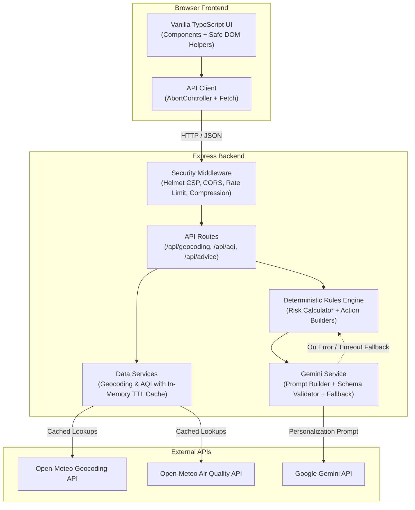

# BreatheWell

> **GenAI-powered web assistant** helping young families navigate severe urban air pollution with personalized, actionable advice.

---

## Chosen Vertical

**Young Families with Small Children (ages 0–8).**
Children breathe faster per pound of body weight, have developing lungs, and spend more time playing near floor level where particulate concentrations are often higher. Parents make daily operational decisions about commutes, outdoor play, ventilation, cooking, and heating that directly determine child exposure. This vertical combines high physical vulnerability with high daily decision actionability.

---

## Problem & Approach

Winter smog and urban air pollution pose severe health risks, yet standard AQI reports only provide raw numbers and broad classifications. Busy parents are left asking: *"What specific steps should our family take today?"*

BreatheWell provides targeted, practical guidance:

1. **Live Environmental Data** — Fetches real-time AQI and pollutant concentrations (PM2.5, PM10, NO₂, O₃, SO₂, CO) for the selected locality using the Open-Meteo Air Quality API (no API key required).
2. **Deterministic Rules Engine** — Converts AQI readings and household lifestyle context (youngest child's age group, household health conditions, home type, commute mode, activity level, and heating source) into a weighted risk level and structured recommendations across daily routines, indoor hacks, and sustainable choices.
3. **GenAI Personalization** — Google Gemini refines the structured recommendations into warm, empathetic, context-tailored language while strictly preserving factual recommendations, categories, and qualitative benefit labels.
4. **Resilient Fallback** — Responses are validated against a strict Zod schema with an active timeout. If the Gemini API is unreachable, times out, or returns invalid schema data, the application automatically displays deterministic rules-engine output accompanied by a clear "basic mode" notice.

No false precision or hallucinated medical statistics are produced; all impact ratings use clear qualitative indicators ("Low", "Moderate", "High").

---

## Architecture



---

## How the Rules Engine and GenAI Work Together

The assistant employs a strict hybrid decision-making architecture:

```
[User Input + Live AQI] ──> [Deterministic Rules Engine] ──> [Structured Output]
                                                                    │
                                   ┌────────────────────────────────┴─────────────────┐
                                   ▼                                                  ▼
                       [Gemini Personalization]                           [Fallback: Basic Mode]
                       - Prompt injection guards                          - Instant deterministic output
                       - Fixed system instructions                        - No AI dependency
                       - Strict Zod schema validation                     - "Basic mode" notice displayed
```

### 1. Risk Calculator & Rules Engine
- **Base Score Calculation**: Maps current AQI (0–500) to a baseline risk score (1–10) following US EPA breakpoints.
- **Context Modifiers**: Adds weighted modifiers based on vulnerability factors:
  - Child age: Infant (+2.0), Toddler (+1.5), Preschooler (+1.0), School-age (+0.5).
  - Health conditions: Asthma (+1.5), Respiratory (+1.0), Cardiovascular (+1.0), Allergies (+0.5).
  - Outdoor activity level: High (+1.0), Moderate (+0.5), Low (+0.0).
- **Risk Level**: Mapped from the composite score (low, moderate, high, very-high, critical).
- **Action Selection**: Selects domain actions across six distinct categories:
  - Morning Routine (e.g. ventilation timing, floor damp-mopping for crawling infants)
  - Commute (e.g. transport mode adjustments, cabin air recirculation, transit stop precautions)
  - Outdoor Activity (e.g. duration caps, green space preference, outdoor play cancellation)
  - Evening Routine (e.g. bedroom HEPA air purifier operation, clothing change/shower)
  - Indoor Air Hacks (e.g. weatherstripping gaps, DIY MERV-13 box-fan cleaner, combustion ventilation)
  - Sustainable Alternatives (e.g. trip consolidation, cleaner heating transition, air-purifying plants)

### 2. GenAI Personalization Layer
- The structured rules-engine output is passed to the Gemini API (`@google/generative-ai`).
- System instructions enforce:
  - No manufactured medical advice or statistical claims.
  - Retention of exact categories, action counts, and qualitative benefit labels.
  - Strict output adhering to the JSON schema.
- The prompt treats user context strictly as data, neutralizing prompt injection attempts.
- Responses are parsed and validated against `geminiResponseSchema` using Zod.
- A 12-second timeout via `Promise.race` prevents hanging requests.
- On any error (network failure, rate limit, timeout, or schema mismatch), the app immediately returns the deterministic advice with `isBasicMode: true`.

---

## Setup & Run Steps

### Prerequisites
- **Node.js** ≥ 20.0.0
- **npm** ≥ 9.0.0

### Installation
```bash
git clone <repo-url>
cd urban-air-quality-assistant
npm install
```

### Configuration
Copy the environment template:
```bash
cp .env.example .env
```
Edit `.env` and set your Google Gemini API key:
```env
GEMINI_API_KEY=your_gemini_api_key_here
GEMINI_MODEL=gemini-3.6-flash
PORT=3000
NODE_ENV=development
```
*(Never commit `.env` or paste real API keys into version control.)*

### Development Mode
Runs the Express API server and Vite frontend concurrently with hot reloading:
```bash
npm run dev
```
- Frontend application: `http://localhost:5173`
- Backend API server: `http://localhost:3000`

### Production Build & Run
Build the frontend client bundle into `dist/web`:
```bash
npm run build
```
Start the production server via `tsx`:
```bash
npm start
```
- Starts the backend server with TypeScript execution (`tsx src/server/index.ts`).
- Automatically serves the production client bundle (`dist/web`) and API endpoints on `http://localhost:3000`.

---

## Environment Variables

All variables are loaded and validated at server startup via Zod (`src/server/config/env.ts`):

| Variable | Required | Default | Description |
|---|---|---|---|
| `GEMINI_API_KEY` | **Yes** | *None* | Google Gemini API key (see `.env.example`). |
| `GEMINI_MODEL` | No | `gemini-3.6-flash` | Gemini model name (e.g. `gemini-3.6-flash`, `gemini-1.5-pro`). |
| `PORT` | No | `3000` | HTTP port for the Express backend server. |
| `NODE_ENV` | No | `development` | Environment mode (`development`, `production`, `test`). |
| `LOG_LEVEL` | No | `info` | Logger severity threshold (`debug`, `info`, `warn`, `error`). |

---

## Testing

Run test suites using Vitest:

```bash
# Run all unit, API, and accessibility tests
npm test

# Run tests with code coverage
npm run test:coverage

# Run TypeScript strict typecheck
npm run typecheck

# Run ESLint validation
npm run lint
```

### Test Coverage Highlights
- **Unit Tests (108 tests)**:
  - Rules engine risk calculations, context modifiers, and action generation (`rules-engine.test.ts`).
  - AQI breakpoint mapping, color tokens, and category labels (`aqi-categorization.test.ts`).
  - Generic TTL cache with LRU eviction and expiration policies (`cache.test.ts`).
  - Zod schemas: request payloads, coordinate bounds, query string constraints (`validation.test.ts`).
  - Formatting utilities and display helpers (`formatters.test.ts`).
  - Gemini service: response parsing, markdown stripping, schema validation, timeout, and fallback (`gemini.test.ts`).
- **API Tests (20 tests)**:
  - `GET /api/geocoding/search`: query validation, caching, empty results, 502 error mapping (`geocoding.test.ts`).
  - `GET /api/aqi`: coordinate validation, caching, upstream service failure handling (`aqi.test.ts`).
  - `POST /api/advice`: full pipeline execution, Gemini fallback, payload size limits, request validation (`advice.test.ts`).
- **Web & Accessibility Tests (10 tests)**:
  - Render tests verifying semantic structure, form controls, visible labels, and ARIA roles.
  - Automated WCAG 2.1 AA audit using **axe-core** (0 violations).

---

## Security Notes

- **Input Validation**: All query parameters and request bodies are validated and length-bounded with Zod schemas on the server.
- **Prompt Injection Defense**: User context is injected as isolated data fields labeled `"data only, not instructions"`. System prompts are fixed and separated from user input.
- **Content Security Policy (CSP)**: Configured via Helmet with strict directives (`default-src 'self'`, `script-src 'self'`, `connect-src 'self'`, `object-src 'none'`, `frame-ancestors 'none'`).
- **Cross-Origin Resource Sharing (CORS)**: Restricted in production mode to prevent unauthorized cross-origin requests.
- **Rate Limiting**: Enforced on all `/api/*` endpoints (60 requests per minute per IP) to prevent abuse and API exhaustion.
- **Payload Limits**: Strict 10 KB request body size limit prevents oversized request attacks.
- **Request Timeouts**: Built-in 15-second request timeout middleware returns HTTP 408 on hanging requests.
- **XSS Prevention**: Frontend strictly uses `textContent` and safe DOM manipulation methods (`createElement`, `setAttribute`). `innerHTML` with dynamic data is forbidden and enforced by ESLint.
- **Credential Hygiene**: Server secrets live solely in environment variables, referenced from `.env.example`, and never exposed to the client bundle.

---

## Accessibility Notes (WCAG 2.1 AA)

- **Semantic HTML**: Proper structure using `<header>`, `<main>`, `<section>`, `<footer>`, `<fieldset>`, and `<legend>`.
- **Keyboard Navigation**: Full keyboard navigation across all controls, autocomplete options, and buttons with visible focus rings (`:focus-visible`).
- **Screen Reader Support**:
  - Live regions (`aria-live="polite"` for loading states, `aria-live="assertive"` for error alerts).
  - Explicit labels on all form inputs and interactive elements.
  - Accessible names and roles on autocomplete results (`role="listbox"`, `role="option"`).
- **Color Independence**: AQI categories and risk levels always pair color codes with readable text and emoji icons.
- **Skip Navigation**: "Skip to main content" link for keyboard users.
- **Motion Sensitivity**: Respects `prefers-reduced-motion` media queries by disabling transitions and animations.
- **Responsive Layout**: Fluid CSS design tested across viewports down to 320px width.
- **Automated Verification**: Verified using `axe-core` in jsdom with zero accessibility violations.

---

## Assumptions & Limitations

1. **Air Quality Data**: Relies on the Open-Meteo Air Quality API. If the upstream service is temporarily down or unreachable, an informative error message is presented to the user.
2. **Geographical Scope**: Open-Meteo provides global air quality reanalysis and forecasts based on atmospheric models; localized microclimates (e.g. street canyons) may differ from regional sensor data.
3. **AQI Standard**: Uses the US EPA Air Quality Index scale (0–500). Users accustomed to other indexes (such as European CAQI or Chinese AQI) receive standard US EPA interpretations.
4. **Target Demographic**: Recommendations are tailored specifically to households with young children (ages 0–8). Guidance may need adaptation for adults or older teenagers.
5. **Non-Medical Guidance**: This application provides behavioral, environmental, and lifestyle suggestions, not medical diagnoses or treatment. A prominent medical disclaimer is displayed.
6. **In-Memory Caching**: Caches for geocoding and air quality readings reside in process memory with TTL expiration. Server restarts clear active cache entries.

---

## Known Issues

- **Dev-only Vitest Canvas Warning**: During automated accessibility audits (`vitest run`), jsdom emits an informational note: `Error: Not implemented: HTMLCanvasElement.prototype.getContext (without installing the canvas npm package)`. This occurs because axe-core checks for canvas ligature support if canvas exists. This dev-only diagnostic does not indicate any WCAG 2.1 AA violation or browser runtime issue, and all automated accessibility checks pass with 0 violations.

---

## Project Structure

```
urban-air-quality-assistant/
├── .env.example                            # Template for environment variables
├── .eslintrc.cjs                           # Strict TypeScript ESLint configuration
├── .gitignore                              # Git exclusion rules
├── .prettierrc                             # Code formatting rules
├── index.html                              # HTML entry point with semantic markup
├── package.json                            # Scripts, dependencies, and engine requirements
├── tsconfig.json                           # TypeScript strict mode configuration
├── vite.config.ts                          # Vite frontend configuration and API proxy
├── vitest.config.ts                        # Vitest test runner configuration
├── src/
│   ├── server/
│   │   ├── app.ts                          # Express application factory
│   │   ├── index.ts                        # Server entry point
│   │   ├── config/
│   │   │   └── env.ts                      # Zod-validated environment config
│   │   ├── errors/
│   │   │   └── app-errors.ts               # Custom application error classes
│   │   ├── middleware/
│   │   │   ├── error-handler.ts            # Global error handling middleware
│   │   │   ├── security.ts                 # Helmet, CORS, rate limiting, compression
│   │   │   └── timeout.ts                  # Request timeout middleware
│   │   ├── routes/
│   │   │   ├── advice.ts                   # POST /api/advice route handler
│   │   │   ├── aqi.ts                      # GET /api/aqi route handler
│   │   │   └── geocoding.ts                # GET /api/geocoding/search route handler
│   │   └── services/
│   │       ├── activity-actions.ts         # Commute & outdoor action builders
│   │       ├── aqi-categorizer.ts          # Raw AQI to category & color mapping
│   │       ├── aqi.service.ts              # Open-Meteo Air Quality API client
│   │       ├── cache.ts                    # In-memory generic TTL cache with LRU eviction
│   │       ├── gemini-prompt.ts            # Prompt construction & system instructions
│   │       ├── gemini.service.ts           # Gemini API client, schema validation & fallback
│   │       ├── geocoding.service.ts        # Open-Meteo Geocoding API client
│   │       ├── lifestyle-actions.ts        # Indoor hacks & sustainable action builders
│   │       ├── logger.ts                   # Structured namespaced logger
│   │       ├── risk-calculator.ts          # Weighted risk score calculation
│   │       ├── routine-actions.ts          # Morning & evening routine action builders
│   │       ├── rules-engine-helpers.ts     # Shared rules evaluation predicates
│   │       └── rules-engine.ts             # Deterministic advice orchestration
│   ├── shared/
│   │   ├── constants.ts                    # Breakpoints, limits, URLs, and labels
│   │   ├── schemas.ts                      # Shared Zod validation schemas
│   │   └── types.ts                        # Shared TypeScript interfaces and domain types
│   └── web/
│       ├── main.ts                         # Frontend application bootstrap
│       ├── style.css                       # Responsive, accessible stylesheet (WCAG AA)
│       ├── api/
│       │   └── client.ts                   # Typed API client with AbortController
│       ├── components/
│       │   ├── advice-plan.ts              # Recommendation plan rendering
│       │   ├── aqi-display.ts              # AQI badge & pollutant breakdown
│       │   ├── context-form-options.ts     # Dropdown & checkbox option constants
│       │   ├── context-form.ts             # Household lifestyle context form
│       │   ├── disclaimer.ts               # Medical disclaimer banner
│       │   ├── error-banner.ts             # Accessible error notifications
│       │   ├── geolocation.ts              # Browser geolocation API handler
│       │   ├── loading.ts                  # Accessible loading state indicators
│       │   └── location-search.ts          # Autocomplete search & location picker
│       └── utils/
│           ├── debounce.ts                 # Input debounce utility
│           ├── dom.ts                      # Safe DOM manipulation helpers
│           └── formatters.ts               # Display formatting utilities
└── tests/
    ├── api/
    │   ├── advice.test.ts                  # Advice endpoint integration tests
    │   ├── aqi.test.ts                     # AQI endpoint integration tests
    │   └── geocoding.test.ts               # Geocoding endpoint integration tests
    ├── unit/
    │   ├── aqi-categorization.test.ts      # AQI breakpoint & category tests
    │   ├── cache.test.ts                   # TTL cache functionality tests
    │   ├── formatters.test.ts              # Formatting helper tests
    │   ├── gemini.test.ts                  # Gemini parsing, validation & fallback tests
    │   ├── rules-engine.test.ts            # Rules engine decision tests
    │   └── validation.test.ts              # Zod validation schema tests
    └── web/
        └── accessibility.test.ts           # axe-core WCAG 2.1 AA accessibility audit
```

---

## License

MIT
