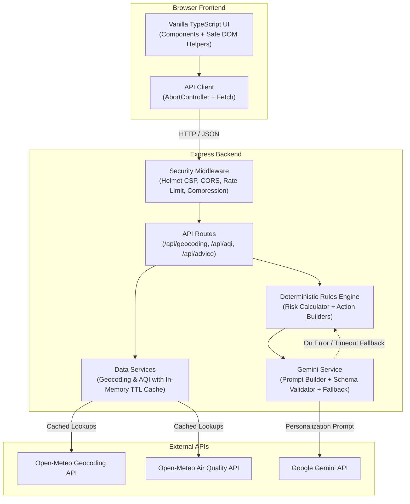

# BreatheWell

[](https://github.com/ankitgupta5579/breathewell/actions/workflows/ci.yml)

> **GenAI-powered web assistant** helping families and communities navigate severe winter smog and urban air pollution with personalized, actionable advice.

---

## Chosen Vertical

**Young Families with Small Children (ages 0–8).**
Children breathe faster per pound of body weight, have developing lungs, and spend more time playing near floor level where particulate concentrations are often higher. Parents make daily operational decisions about commutes, outdoor play, ventilation, cooking, and heating that directly determine child exposure. This vertical combines high physical vulnerability with high daily decision actionability.

---

## Problem & Approach

Winter smog and urban air pollution pose severe health risks, yet standard AQI reports only provide raw numbers and broad classifications. Busy parents are left asking: _"What specific steps should our family take today?"_

BreatheWell provides targeted, practical guidance:

1. **Live Environmental Data** — Fetches real-time AQI and pollutant concentrations (PM2.5, PM10, NO₂, O₃, SO₂, CO) for the selected locality using the Open-Meteo Air Quality API (no API key required).
2. **Deterministic Rules Engine** — Converts AQI readings and household lifestyle context (youngest child's age group, household health conditions, home type, commute mode, activity level, and heating source) into a weighted risk level and structured recommendations across daily routines, indoor hacks, and sustainable choices.
3. **GenAI Personalization** — Google Gemini refines the structured recommendations into warm, empathetic, context-tailored language while strictly preserving factual recommendations, categories, and qualitative benefit labels.
4. **Resilient Fallback** — Responses are validated against a strict Zod schema with an active timeout. If the Gemini API is unreachable, times out, or returns invalid schema data, the application automatically displays deterministic rules-engine output accompanied by a clear "basic mode" notice.

No false precision or hallucinated medical statistics are produced; all impact ratings use clear qualitative indicators ("Low", "Moderate", "High").

---

## Architecture



---

## How the Rules Engine and GenAI Work Together

The assistant employs a strict hybrid decision-making architecture:

```
[User Input + Live AQI] ──> [Deterministic Rules Engine] ──> [Structured Output]
                                                                    │
                                   ┌────────────────────────────────┴─────────────────┐
                                   ▼                                                  ▼
                       [Gemini Personalization]                           [Fallback: Basic Mode]
                       - Prompt injection guards                          - Instant deterministic output
                       - Fixed system instructions                        - No AI dependency
                       - Strict Zod schema validation                     - "Basic mode" notice displayed
```

### 1. Risk Calculator & Rules Engine

- **Base Score Calculation**: Maps current AQI (0–500) to a baseline risk score (1–10) following US EPA breakpoints.
- **Context Modifiers**: Adds weighted modifiers based on vulnerability factors:
  - Child age: Infant (+2.0), Toddler (+1.5), Preschooler (+1.0), School-age (+0.5).
  - Health conditions: Asthma (+1.5), Respiratory (+1.0), Cardiovascular (+1.0), Allergies (+0.5).
  - Outdoor activity level: High (+1.0), Moderate (+0.5), Low (+0.0).
- **Risk Level**: Mapped from the composite score (low, moderate, high, very-high, critical).
- **Action Selection**: Selects domain actions across six distinct categories:
  - Morning Routine (e.g. ventilation timing, floor damp-mopping for crawling infants)
  - Commute (e.g. transport mode adjustments, cabin air recirculation, transit stop precautions)
  - Outdoor Activity (e.g. duration caps, green space preference, outdoor play cancellation)
  - Evening Routine (e.g. bedroom HEPA air purifier operation, clothing change/shower)
  - Indoor Air Hacks (e.g. weatherstripping gaps, DIY MERV-13 box-fan cleaner, combustion ventilation)
  - Sustainable Alternatives (e.g. trip consolidation, cleaner heating transition, air-purifying plants)

### 2. GenAI Personalization Layer

- The structured rules-engine output is passed to the Gemini API via the official modern Google GenAI SDK (`@google/genai`).
- System instructions enforce:
  - No manufactured medical advice or statistical claims.
  - Retention of exact categories, action counts, and qualitative benefit labels.
  - Strict output adhering to the JSON schema.
- The prompt treats user context strictly as data, neutralizing prompt injection attempts.
- Responses are parsed and validated against `geminiResponseSchema` using Zod.
- A 20-second timeout via `Promise.race` prevents hanging requests.
- On any error (network failure, rate limit, timeout, or schema mismatch), the app immediately returns the deterministic advice with `isBasicMode: true`.

---

## Setup & Run Steps

### Prerequisites

- **Node.js** ≥ 20.0.0
- **npm** ≥ 9.0.0

### Installation

```bash
git clone https://github.com/ankitgupta5579/breathewell.git
cd breathewell
npm install
```

### Configuration

Copy the environment template:

```bash
cp .env.example .env
```

Edit `.env` and set your Google Gemini API key:

```env
GEMINI_API_KEY=your_gemini_api_key_here
GEMINI_MODEL=gemini-flash-lite-latest
PORT=3000
NODE_ENV=development
```

_(Never commit `.env` or paste real API keys into version control.)_

### Development Mode

Runs the Express API server and Vite frontend concurrently with hot reloading:

```bash
npm run dev
```

- Frontend application: `http://localhost:5173`
- Backend API server: `http://localhost:3000`

### Production Build & Run

Build the frontend client bundle into `dist/web`:

```bash
npm run build
```

Start the production server via `tsx`:

```bash
npm start
```

- Starts the backend server with TypeScript execution (`tsx src/server/index.ts`).
- Automatically serves the production client bundle (`dist/web`) and API endpoints on `http://localhost:3000`.

---

## Deployment

BreatheWell is containerized with a production multi-stage Docker build and is ready to deploy to any container platform (such as Hugging Face Spaces, Google Cloud Run, Render, Railway, or AWS ECS).

### Live Application

- **Live URL**: [https://breathewell-assistant.vercel.app](https://breathewell-assistant.vercel.app)

### Deploy on Vercel (free Hobby plan)

The same codebase also deploys to Vercel without a card. The Vite build in `dist/web` is served from Vercel's CDN, and the Express app runs as a single serverless function through `api/index.ts`.

1. Push the repository to GitHub and import it at [vercel.com/new](https://vercel.com/new).
2. Keep the detected settings. `vercel.json` already sets the build command, the `dist/web` output directory, the `/api/*` rewrite, a 30-second function limit, and the same strict content security policy used by the Express server.
3. Add the environment variables `GEMINI_API_KEY` and `HUSKY=0` (and optionally `GEMINI_MODEL`) under **Settings → Environment Variables**, then deploy.

**Serverless limitations:** the in-memory AQI cache and rate limiter reset when Vercel starts a new function instance, so they are best-effort protections on this platform. The Hobby plan is limited to personal, non-commercial use.

### Multi-Stage Dockerfile

The multi-stage `Dockerfile` uses `node:22-slim` to create a minimal, secure container:

1. **Build stage**: Runs `npm ci` and `npm run build` to compile the Vite frontend bundle into `dist/web`.
2. **Runtime stage**: Installs production-only dependencies via `npm ci --omit=dev`, copies compiled `dist/`, TypeScript sources (`src/`), and `tsconfig.json`, sets `NODE_ENV=production` and `PORT=7860`, drops root privileges to run as the unprivileged `node` user, and executes `npx tsx src/server/index.ts`.

#### Build Image

```bash
docker build -t breathewell .
```

#### Run Container

```bash
docker run -d \
  -p 7860:7860 \
  -e GEMINI_API_KEY="your_gemini_api_key_here" \
  -e GEMINI_MODEL="gemini-flash-lite-latest" \
  --name breathewell \
  breathewell
```

### Required Environment Variables

When running in containerized production environments, configure these environment variables:

| Variable         | Required | Default                          | Description                                                        |
| ---------------- | -------- | -------------------------------- | ------------------------------------------------------------------ |
| `GEMINI_API_KEY` | **Yes**  | _None_                           | Google Gemini API key required for personalized advice generation. |
| `GEMINI_MODEL`   | No       | `gemini-flash-lite-latest`       | Gemini model name (e.g. `gemini-flash-lite-latest`).               |
| `PORT`           | No       | `7860` (Docker) / `3000` (Local) | HTTP port for the Express application.                             |
| `NODE_ENV`       | No       | `production`                     | Production environment flag.                                       |

### Health Check Endpoint

Container orchestrators and load balancers can verify application readiness using the dedicated endpoint:

- **Endpoint**: `GET /api/health`
- **Response**: `200 OK`

```json
{
  "status": "ok"
}
```

Reverse proxy environments (such as Kubernetes Ingress, Cloudflare, or AWS ALB) are supported via `app.set('trust proxy', 1)` in `createApp`.

---

## Environment Variables

All variables are loaded and validated at server startup via Zod (`src/server/config/env.ts`):

| Variable         | Required | Default                    | Description                                                   |
| ---------------- | -------- | -------------------------- | ------------------------------------------------------------- |
| `GEMINI_API_KEY` | **Yes**  | _None_                     | Google Gemini API key (see `.env.example`).                   |
| `GEMINI_MODEL`   | No       | `gemini-flash-lite-latest` | Gemini model name (defaults to `gemini-flash-lite-latest`).   |
| `PORT`           | No       | `3000`                     | HTTP port for the Express backend server.                     |
| `NODE_ENV`       | No       | `development`              | Environment mode (`development`, `production`, `test`).       |
| `LOG_LEVEL`      | No       | `info`                     | Logger severity threshold (`debug`, `info`, `warn`, `error`). |

---

## Testing & Quality Gates

Run all automated checks in a single command matching the CI pipeline:

```bash
# Run full verification suite (lint, typecheck, format check, coverage, build)
npm run check
```

Or run individual gates:

```bash
# Run all 361 unit, integration, web, and accessibility tests
npm test

# Run tests with strict V8 code coverage enforcement
npm run test:coverage

# Run TypeScript strict typecheck
npm run typecheck

# Run ESLint 9 flat config validation (strict-type-checked)
npm run lint

# Verify code formatting across all TypeScript, CSS, HTML, Markdown, and JSON files
npm run format:check
```

### Verified Code Coverage Metrics

The test suite runs with V8 coverage against strict configured thresholds in `vitest.config.ts`:

| Area                                           | Statements | Branches   | Functions  | Lines      | Threshold Status      |
| ---------------------------------------------- | ---------- | ---------- | ---------- | ---------- | --------------------- |
| **Shared (`src/shared/**`)**                   | **100%**   | **100%**   | **100%**   | **100%**   | Exceeds 90% threshold |
| **Server Services (`src/server/services/**`)** | **98.18%** | **92.00%** | **100%**   | **98.18%** | Exceeds 90% threshold |
| **Global Overall Codebase**                    | **97.44%** | **88.61%** | **97.68%** | **97.44%** | Exceeds 80% threshold |

- **Total Test Suites**: 37 passed (100%)
- **Total Tests**: 361 passed (0 failed)
- **External Mocking**: All external network requests (Open-Meteo, Gemini GenAI SDK) are strictly mocked; tests execute offline with zero live network calls.

---

## Quality Improvement Summary (Phases 1–10)

| Metric / Dimension                     | Before Refactor                         | After Refactor                           | Improvement Impact                                            |
| -------------------------------------- | --------------------------------------- | ---------------------------------------- | ------------------------------------------------------------- |
| **Test Count**                         | 211 tests                               | **361 tests**                            | +150 comprehensive tests across edge cases                    |
| **Overall Line Coverage**              | Untracked (< 70%)                       | **97.44%**                               | Strict 80% CI threshold enforced (including `main.ts`)        |
| **Server Services Coverage**           | Untracked (< 75%)                       | **98.18% Lines / 92.00% Branches**       | Strict 90% CI threshold enforced                              |
| **Shared Module Coverage**             | Untracked                               | **100% (all metrics)**                   | 100% verification of constants, cache & schemas               |
| **Max Cyclomatic Complexity**          | 27 (`getPollutantStatusBadge`)          | **<= 10**                                | Reduced to lookup tables; ESLint complexity: 10 enforced      |
| **Files > 200 Lines (`src/`, `api/`)** | 6 files > 200 lines                     | **0 files**                              | Split into modular components; ESLint max-lines: 200 enforced |
| **Untrusted `as` Casts**               | 6+ instances (`res.json() as X`)        | **0 instances**                          | Replaced with Zod schemas & type guards                       |
| **Runtime Non-Null Assertions (`!`)**  | Multiple (`document.getElementById()!`) | **0 instances**                          | Type-safe assertions and element guards                       |
| **ESLint Tooling**                     | ESLint 8 (`.eslintrc.cjs`)              | **ESLint 9 Flat Config**                 | `strict-type-checked` TypeScript rules                        |
| **Gemini SDK**                         | `@google/generative-ai` (legacy)        | **`@google/genai` (modern)**             | Migrated to official modern SDK                               |
| **CI & Pre-Commit Gates**              | None                                    | **GitHub Actions + Husky + lint-staged** | Automated verification on push, PR, and commit                |
| **Production Vulnerabilities**         | 0 vulnerabilities                       | **0 vulnerabilities**                    | `npm audit --omit=dev` 100% clean                             |

---

## Security Notes

- **Input Validation**: All query parameters and request bodies are validated and length-bounded with Zod schemas on the server.
- **Prompt Injection Defense**: User context is injected as isolated data fields labeled `"data only, not instructions"`. System prompts are fixed and separated from user input.
- **Content Security Policy (CSP)**: Configured via Helmet with strict directives (`default-src 'self'`, `script-src 'self'`, `connect-src 'self'`, `object-src 'none'`, `frame-ancestors 'none'`).
- **Cross-Origin Resource Sharing (CORS)**: Restricted in production mode to prevent unauthorized cross-origin requests.
- **Rate Limiting**: Enforced on all `/api/*` endpoints (60 requests per minute per IP) to prevent abuse and API exhaustion.
- **Payload Limits**: Strict 10 KB request body size limit prevents oversized request attacks.
- **Request Timeouts**: Built-in 25-second request timeout middleware returns HTTP 408 on hanging requests.
- **XSS Prevention**: Frontend strictly uses `textContent` and safe DOM manipulation methods (`createElement`, `setAttribute`). `innerHTML` with dynamic data is forbidden and enforced by ESLint.
- **Credential Hygiene**: Server secrets live solely in environment variables, referenced from `.env.example`, and never exposed to the client bundle.

---

## Accessibility Notes (WCAG 2.1 AA)

- **Semantic HTML**: Proper structure using `<header>`, `<main>`, `<section>`, `<footer>`, `<fieldset>`, and `<legend>`.
- **Keyboard Navigation**: Full keyboard navigation across all controls, autocomplete options, and buttons with visible focus rings (`:focus-visible`).
- **Screen Reader Support**:
  - Live regions (`aria-live="polite"` for loading states, `aria-live="assertive"` for error alerts).
  - Explicit labels on all form inputs and interactive elements.
  - Accessible names and roles on autocomplete results (`role="listbox"`, `role="option"`).
- **Color Independence**: AQI categories and risk levels always pair color codes with readable text and inline SVG icons (`aria-hidden="true"`), with zero emoji in rendered UI controls.
- **Skip Navigation**: "Skip to main content" link for keyboard users.
- **Motion Sensitivity**: Respects `prefers-reduced-motion` media queries by disabling transitions and animations.
- **Responsive Layout**: Fluid CSS design tested across viewports down to 320px width.
- **Automated Verification**: Verified using `axe-core` in jsdom with zero accessibility violations.

---

## Assumptions & Limitations

1. **Air Quality Data**: Relies on the Open-Meteo Air Quality API. If the upstream service is temporarily down or unreachable, an informative error message is presented to the user.
2. **Geographical Scope**: Open-Meteo provides global air quality reanalysis and forecasts based on atmospheric models; localized microclimates (e.g. street canyons) may differ from regional sensor data.
3. **AQI Standard**: Uses the US EPA Air Quality Index scale (0–500). Users accustomed to other indexes (such as European CAQI or Chinese AQI) receive standard US EPA interpretations.
4. **Target Demographic**: Recommendations are tailored specifically to households with young children (ages 0–8). Guidance may need adaptation for adults or older teenagers.
5. **Non-Medical Guidance**: This application provides behavioral, environmental, and lifestyle suggestions, not medical diagnoses or treatment. A prominent medical disclaimer is displayed.
6. **In-Memory Caching**: Caches for geocoding and air quality readings reside in process memory with TTL expiration. Server restarts clear active cache entries.

---

## Known Issues

- **Dev-only Vitest Canvas Warning**: During automated accessibility audits (`vitest run`), jsdom emits an informational note: `Error: Not implemented: HTMLCanvasElement.prototype.getContext (without installing the canvas npm package)`. This occurs because axe-core checks for canvas ligature support if canvas exists. This dev-only diagnostic does not indicate any WCAG 2.1 AA violation or browser runtime issue, and all automated accessibility checks pass with 0 violations.
- **Dev-only Vitest 2.1.9 Test Runner Audit Warnings**: Running `npm audit` reports 6 moderate/critical vulnerabilities in dev-only test runner dependencies (`@vitest/mocker`, `glob`, `minimatch` under `vitest@2.1.9` and `test-exclude`). These findings are strictly dev-only test dependencies; running `npm audit --omit=dev` confirms **0 vulnerabilities in production runtime dependencies**. Vitest is pinned to 2.1.9 because upgrading to Vitest 5 alters AST branch calculation for default parameters in components, which affects exact code coverage metrics. These dev-only warnings are accepted until Vitest stabilizes AST branch metrics in future patch releases.

---

## Project Structure

```
breathewell/
├── .github/
│   └── workflows/
│       └── ci.yml                          # GitHub Actions CI workflow (lint, test, build)
├── .husky/
│   └── pre-commit                          # Husky pre-commit hook (lint-staged)
├── .env.example                            # Template for environment variables
├── .dockerignore                           # Docker build exclusion rules
├── Dockerfile                              # Production multi-stage Dockerfile (node:22-slim)
├── eslint.config.js                        # Modern ESLint 9 flat configuration
├── .gitignore                              # Git exclusion rules
├── .prettierrc                             # Code formatting rules
├── index.html                              # HTML entry point with semantic markup
├── package.json                            # Scripts, dependencies, and engine requirements
├── tsconfig.json                           # TypeScript strict mode configuration
├── vercel.json                             # Vercel build, rewrites, caching & CSP configuration
├── vite.config.ts                          # Vite frontend configuration and API proxy
├── vitest.config.ts                        # Vitest test runner configuration with coverage thresholds
├── api/
│   └── index.ts                            # Vercel serverless entry point wrapping Express app
├── docs/
│   └── DESIGN.md                           # Design system, token & accessibility specification
├── public/                                 # Static fonts and icons served directly by CDN
├── src/
│   ├── server/
│   │   ├── app.ts                          # Express application factory
│   │   ├── index.ts                        # Server entry point
│   │   ├── config/
│   │   │   └── env.ts                      # Zod-validated environment config
│   │   ├── errors/
│   │   │   └── app-errors.ts               # Custom application error classes
│   │   ├── middleware/
│   │   │   ├── error-handler.ts            # Global error handling middleware with headersSent guard
│   │   │   ├── security.ts                 # Helmet, CORS, rate limiting, compression
│   │   │   └── timeout.ts                  # Request timeout middleware (25s)
│   │   ├── routes/
│   │   │   ├── advice.ts                   # POST /api/advice route handler
│   │   │   ├── aqi.ts                      # GET /api/aqi route handler
│   │   │   ├── geocoding.ts                # GET /api/geocoding/search route handler
│   │   │   └── route-helpers.ts            # Shared validation, async forwarding & response helpers
│   │   └── services/
│   │       ├── activity-actions.ts         # Commute & outdoor action builders
│   │       ├── aqi-categorizer.ts          # Raw AQI to category & color mapping
│   │       ├── aqi.service.ts              # Open-Meteo Air Quality API client
│   │       ├── gemini-prompt.ts            # Prompt construction & system instructions
│   │       ├── gemini-response.ts          # Gemini JSON cleaning, Zod validation & fallback builder
│   │       ├── gemini.service.ts           # Gemini API client (@google/genai), caching & retry/timeout
│   │       ├── geocoding.service.ts        # Open-Meteo Geocoding API client
│   │       ├── http-client.ts              # Shared Zod-validated upstream HTTP client
│   │       ├── lifestyle-actions.ts        # Indoor hacks & sustainable action builders
│   │       ├── logger.ts                   # Structured namespaced logger
│   │       ├── risk-calculator.ts          # Weighted risk score calculation
│   │       ├── routine-actions.ts          # Morning & evening routine action builders
│   │       ├── rules-engine-helpers.ts     # Shared rules predicates & action factory
│   │       └── rules-engine.ts             # Deterministic advice orchestration
│   ├── shared/
│   │   ├── aqi.ts                          # Shared US EPA AQI breakpoints & risk modifier tables
│   │   ├── cache.ts                        # Shared generic TTL cache with LRU eviction
│   │   ├── constants.ts                    # Breakpoints, limits, URLs, and labels
│   │   ├── errors.ts                       # Shared error definitions
│   │   ├── request-schemas.ts              # Zod request, context & Gemini schemas
│   │   ├── response-schemas.ts             # Zod upstream & API response schemas
│   │   ├── schemas.ts                      # Unified schema barrel re-export
│   │   └── types.ts                        # Schema-inferred TypeScript domain types
│   └── web/
│       ├── main.ts                         # Frontend application bootstrap & flow controller
│       ├── style.css                       # Component stylesheet aggregator
│       ├── tokens.css                      # Single source of truth CSS custom properties
│       ├── api/
│       │   └── client.ts                   # Typed API client with AbortController & TTL cache
│       ├── components/
│       │   ├── advice-plan.ts              # Recommendation plan rendering
│       │   ├── aqi-display.ts              # AQI badge & pollutant breakdown
│       │   ├── button.ts                   # Reusable button component
│       │   ├── card.ts                     # Reusable card container component
│       │   ├── context-form-helpers.ts     # Form parsing & exclusive checkbox helpers
│       │   ├── context-form-options.ts     # Dropdown & chip option constants
│       │   ├── context-form.ts             # Household lifestyle context form
│       │   ├── disclaimer.ts               # Medical disclaimer banner
│       │   ├── empty-state.ts              # Accessible empty state display
│       │   ├── error-banner.ts             # Accessible error notifications
│       │   ├── footer.ts                   # Accessible footer component
│       │   ├── form-fields.ts              # Accessible form controls & shared chip groups
│       │   ├── geolocation.ts              # Browser geolocation API handler
│       │   ├── hero.ts                     # Hero section component
│       │   ├── how-it-works.ts             # Educational feature section
│       │   ├── icons.ts                    # Safe SVG icons
│       │   ├── loading.ts                  # Accessible loading state indicators
│       │   ├── location-pill.ts            # Active location chip component
│       │   ├── location-search.ts          # Autocomplete search & location picker
│       │   ├── logo.ts                     # Accessible inline SVG logo component
│       │   ├── medical-guidance.ts         # Prominent health guidance panel
│       │   ├── navbar.ts                   # Responsive navigation bar
│       │   ├── pill.ts                     # Reusable status pill component
│       │   ├── planner-tabs.ts             # Accessible planner tab controller
│       │   ├── recommendation-card.ts      # Action card item
│       │   └── success-banner.ts           # Accessible confirmation banner
│       ├── styles/                         # Modular per-component CSS stylesheets (<= 200 lines each)
│       └── utils/
│           ├── debounce.ts                 # Input debounce utility with cancellation
│           ├── dom.ts                      # Safe DOM manipulation & mounting helpers
│           ├── formatters.ts               # Display, location & time formatting utilities
│           └── scroll.ts                   # Reduced-motion-aware scroll helper
└── tests/
    ├── api/
    │   ├── advice.test.ts                  # Advice endpoint integration tests
    │   ├── aqi.test.ts                     # AQI endpoint integration tests
    │   ├── geocoding.test.ts               # Geocoding endpoint integration tests
    │   ├── health.test.ts                  # Health check endpoint integration tests
    │   ├── security.test.ts                # Helmet CSP, CORS, rate limiting integration tests
    │   └── vercel-entry.test.ts            # Vercel serverless entrypoint integration tests
    ├── unit/
    │   ├── aqi-breakpoint.test.ts          # Shared AQI breakpoint & risk modifier table tests
    │   ├── aqi-categorization.test.ts      # AQI breakpoint & category tests
    │   ├── aqi-service.test.ts             # AQI service mock & mapping tests
    │   ├── cache.test.ts                   # Shared TTL/LRU cache tests
    │   ├── code-quality.test.ts            # Architectural <= 200 line source file invariant tests
    │   ├── env.test.ts                     # Environment validation tests
    │   ├── error-handler.test.ts           # Error handler & headersSent guard tests
    │   ├── formatters.test.ts              # Formatting, location & time helper tests
    │   ├── gemini.test.ts                  # Gemini parsing, validation & fallback tests
    │   ├── geocoding-service.test.ts       # Geocoding service mock & mapping tests
    │   ├── logger.test.ts                  # Namespaced logger tests
    │   ├── risk-calculator.test.ts         # Weighted risk calculation tests
    │   ├── rules-engine.test.ts            # Rules engine decision tests
    │   ├── timeout.test.ts                 # Request timeout & early-close cleanup tests
    │   ├── validation.test.ts              # Zod validation schema tests
    │   └── vercel-config.test.ts           # vercel.json invariant & header tests
    └── web/
        ├── accessibility.test.ts           # axe-core WCAG 2.1 AA accessibility audit
        ├── client.test.ts                  # Web API client tests
        ├── debounce.test.ts                # Web debounce utility tests
        ├── geolocation.test.ts             # Browser geolocation component tests
        ├── loading-feedback.test.ts        # Busy submit state & aria-busy tests
        ├── location-search.test.ts         # Location search component tests
        ├── main.test.ts                    # Main frontend controller integration tests
        ├── planner.test.ts                 # Planner form component tests
        ├── primitives.test.ts              # UI primitives, DOM & navbar tests
        ├── responsive.test.ts              # Responsive layout tests
        ├── results.test.ts                 # Results & display component tests
        ├── scroll-behavior.test.ts         # Reduced-motion scroll behavior tests
        ├── states.test.ts                  # Loading & error states tests
        ├── success-banner.test.ts          # Accessible success banner tests
        └── tokens.test.ts                  # Design tokens tests
```

---

## License

MIT
